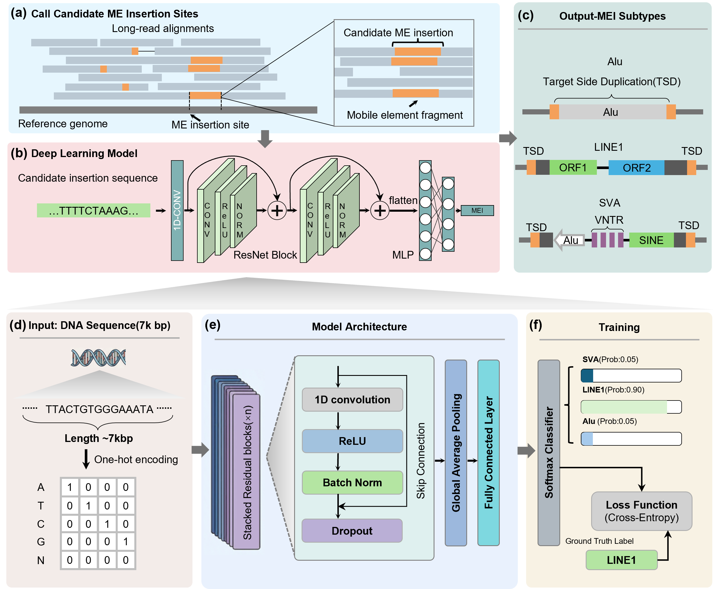

# MEIsensor (v2.1)

MEIsensor is a tool for detecting, classifying and annotating mobile element insertions (MEIs) from long-read sequencing data. It calls insertions from aligned reads, classifies each insertion as Alu, LINE1 or SVA with a trained convolutional neural network, and annotates every call in the output VCF (annotation is on by default when a reference is supplied; `--annotate false` disables it).

## Overview

MEIsensor extracts split-read and inline insertion signals from a coordinate-sorted BAM, clusters them into candidate insertions, and assembles a consensus insertion sequence from the supporting reads. Each candidate is then classified by the neural network; insertions that are not classified as MEI are dropped, so the output VCF only contains Alu/LINE1/SVA calls.



## Installation

Tested on Linux with Python 3.10–3.12 and PyTorch 2.7–2.11 (CUDA 12.8) and an NVIDIA GPU. The 2026-11-27 reference run used Python 3.12.3, PyTorch 2.11.0+cu128, pysam 0.22.0, numpy 1.26.4 and pandas 2.1.4 (RTX 5060 Ti).

```bash
git clone https://github.com/Yudong-XJTU/MEIsensor-release.git
cd MEIsensor-release
```

With CUDA 12.8 or higher:

```bash
conda env create -f environment.yml -n MEIsensor
conda activate MEIsensor
```

For other CUDA versions, install manually and pick the PyTorch build that matches yours:

```bash
conda create -n MEIsensor python=3.10
conda activate MEIsensor
pip install torch==2.7.0 torchvision==0.22.0 torchaudio==2.7.0 --index-url https://download.pytorch.org/whl/cu128
pip install -r requirements.txt
```

Check CUDA:

```bash
python -c "import torch; print(torch.__version__, torch.version.cuda, torch.cuda.is_available())"
```

## Usage

```bash
python src/main.py -i $BAM_PATH -v $OUTPUT_PATH --reference $REF_PATH -m $MODEL_PATH -t $THREAD
```

Example:

```bash
python src/main.py \
    -i sample.hifi.minimap2.sorted.bam \
    -v sample.MEI.vcf \
    --reference GRCh38.fasta \
    -m src/trained_model/seq_classify_model.ph \
    -t 12
```

Parameters:

```text
-i BAM_PATH                       coordinate-sorted, indexed .bam of aligned long reads
-v OUTPUT_PATH                    output VCF (.vcf or bgzipped .vcf.gz)
--reference REF_PATH              reference genome the reads were aligned to
-m MODEL_PATH                     trained model, shipped at src/trained_model/seq_classify_model.ph
-t THREAD                         number of threads (default 4)
--allow-overwrite                 overwrite the output VCF if it already exists (default: off)
--annotate TRUE|FALSE             annotate each insertion (default: on when --reference is given;
                                  use --annotate false to disable)
```

The reference is needed for classification: the base at each insertion site is taken from it and prepended to the ALT sequence before the model is applied. Without a reference no classified calls are written. Use the same reference the BAM was aligned against.

### Annotation

Annotation is part of the normal output: whenever `--reference` is supplied, every
sequence-resolved insertion is annotated directly in the output VCF INFO field. It can be
switched off with `--annotate false`. All annotation is computed by MEIsensor itself from
the reference genome; no external annotation tool is needed:

```bash
python src/main.py -i sample.hifi.minimap2.sorted.bam -v sample.MEI.vcf \
    --reference GRCh38.fasta -m src/trained_model/seq_classify_model.ph -t 12
```

- **EN motif**: the EN nick is anchored at the physical TSD boundary (no reference scan). For `POLYA_STRAND` `+`, the first nick is on the bottom strand at the TSD 5′ boundary and the 12-bp window is the reverse complement of `ref[start-6:start+6]`; for `-`, the top-strand nick is at the TSD 3′ boundary and the window is `ref[end-6:end+6]`. `EN_MOTIF` reports the 6-bp core (positions -4..-1 and +1..+2) as a T-tract/A-tract, `EN_STRAND` the nicked strand, and `EN_OFFSET` is 0.
- **TSD (target-site duplication)**: the longest **exact (0-mismatch)** match between the inserted sequence (ALT without the anchor base) and the reference sequence immediately flanking the insertion, requiring at least 4 bp — `TSD_LEN` (bp; 0 when no duplication is detected) and `TSD_SEQ`. No mismatches are tolerated and the anchor base is not counted.
- **poly(A/T) tail**: measured on the inserted sequence **after removing the TSD**. A terminal A-rich tract (3' end, `POLYA_STRAND=+`) or T-rich tract (5' end, `POLYA_STRAND=-`) is accepted when it is at least 10 bp long and every 10-bp window at the terminus is at least 80% pure — `POLYA_LEN` (bp; 0 when no tail is detected), `POLYA_SEQ`, `POLYA_STRAND`.

## Output

The output is a standard VCF:

- ID: `MEIsensor.ALU.INS`, `MEIsensor.LINE1.INS` or `MEIsensor.SVA.INS`
- REF/ALT: reference base at the insertion point, and the reference base plus the assembled insertion sequence
- INFO: call statistics; with annotation enabled (the default when `--reference` is given) also `EN_*`, `TSD_*` and `POLYA_*` annotation fields

## Demo

`demo/data/demo.bam` contains a small HiFi BAM extracted from HG00513 (chr3:110-113Mb). It calls 3 MEIs (1 Alu, 1 LINE1, 1 SVA), all of them true insertions that match the benchmark dataset at exact positions. Run it from the repository root:

```bash
python src/main.py -i demo/data/demo.bam -v demo/result/demo.MEI.vcf \
    --reference GRCh38.fasta -m src/trained_model/seq_classify_model.ph -t 8 \
    --allow-overwrite
```

`demo/result/` holds the expected output, including the `EN_*`, `TSD_*` and `POLYA_*` annotation fields. The command regenerates `demo/result/demo.MEI.vcf` in place; `--allow-overwrite` is required because that file is shipped with the repository. Annotation is on by default because `--reference` is given; it can be disabled with `--annotate false`.

On a SLURM cluster, set `REF` in `demo/run_demo.sbatch` to your reference genome, then:

```bash
sbatch demo/run_demo.sbatch
```


See `CHANGELOG.md` for the annotation revision history.

## Acknowledgements
We are grateful to the Human Genome Structural Variation Consortium (HGSVC) for the long-read benchmark data and sample materials, to the Genome in a Bottle (GIAB) consortium for the GRCh38 segmental-duplication and centromere annotations used to define complex regions, and to UCSC for the hg38 reference genome.

MEIsensor builds on excellent open-source software, including minimap2, hifiasm, SVIM-asm, SVAN, Tandem Repeats Finder, RepeatMasker, Dfam, PyTorch, pysam, NumPy, pandas, matplotlib and logomaker. We thank their developers and maintainers for making these tools available.

We also thank colleagues and users who tested early versions of MEIsensor and provided feedback that helped improve the tool.

The candidate insertion extraction logic was inspired by Sniffles2 (https://github.com/fritzsedlazeck/Sniffles). We thank the Sniffles2 developers for making their implementation openly available.

## License

MEIsensor is released under the MIT License. See [LICENSE](LICENSE) for the full text.

Copyright (c) 2026 Yudong Wang, Kai Ye, Xiaofei Yang, and Xi'an Jiaotong University.
